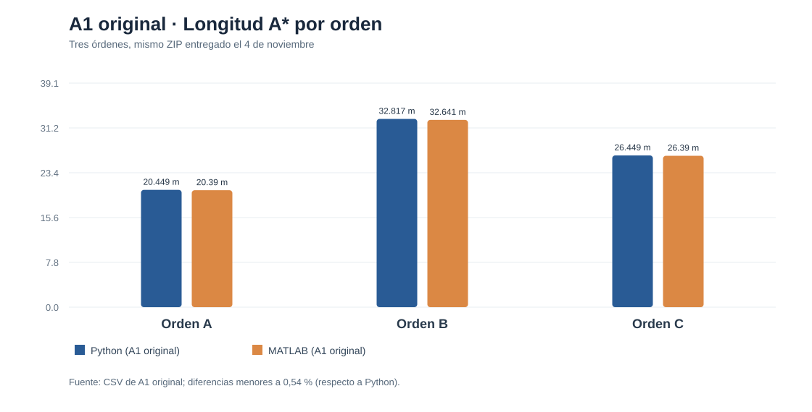
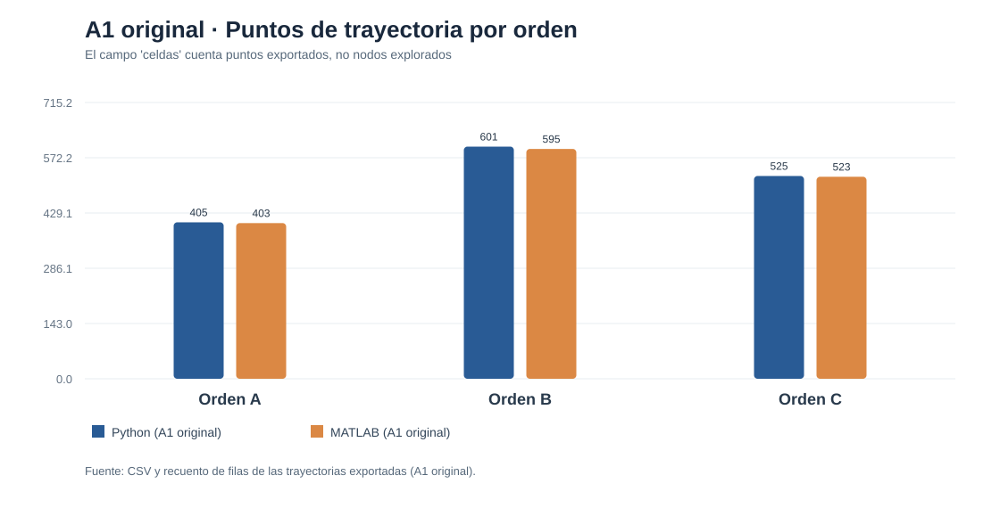
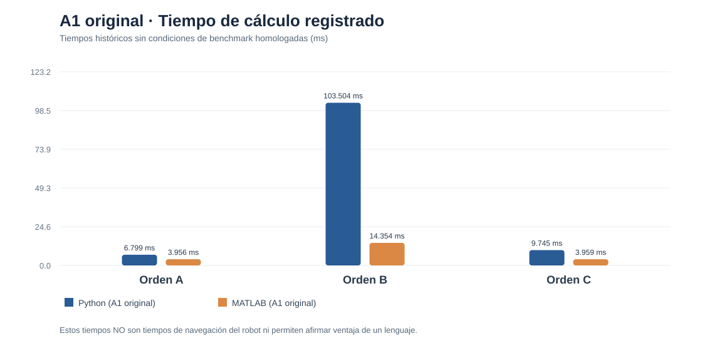
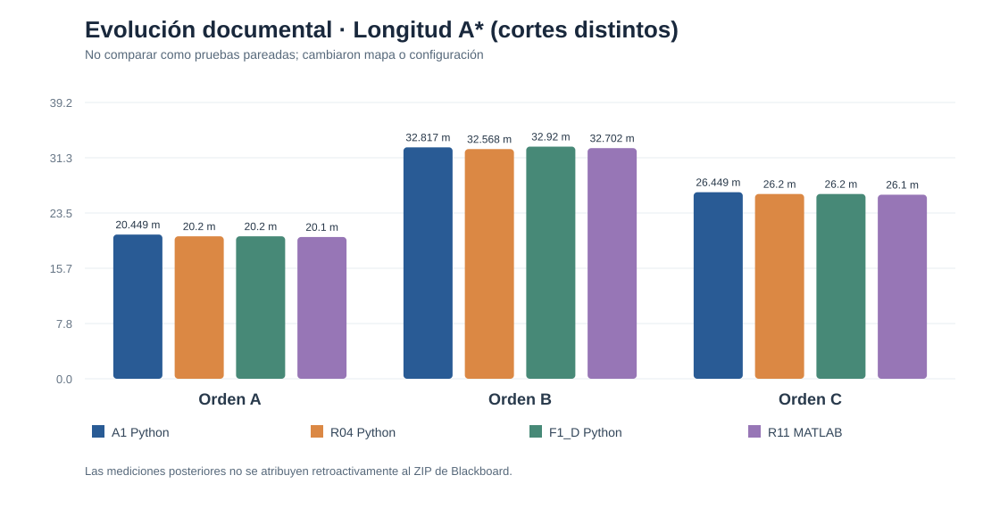

# A1 — Actividad 9: consolidación verificable de planificación A*

## Alcance y cortes históricos

- **Entrega Blackboard (4-11-2026):** archivo `AMR_Logistico_Fase_1-main.zip`, SHA-256 `398835963816b9cf429ab68283b27340d6481fffa5006b115b6cad4cfc21502b`; corresponde a Git `d1558d7e8845acf453a3b6eee5a1c62af947b3cf` (actividad A1-ACT5).
- **Datos posteriores:** fuentes archivadas en el commit de entrega U3S7 `e38b177e373e3a68c2e77d478231b3e97f658f4b` (tag `final`); no corresponden al corte presentado para A1.
- **Método:** análisis estático de CSV y trayectorias guardadas. No se reejecutan MATLAB, Python A*, ROS 2 ni Gazebo.

## 1. Comparación principal: A1 original

| Orden | Python (m) | MATLAB (m) | Δ absoluto (m) | Δ / Python (%) | Puntos Python | Puntos MATLAB | Python (ms) | MATLAB (ms) |
|---|---:|---:|---:|---:|---:|---:|---:|---:|
| A | 20.449 | 20.390 | 0.059 | 0.289 % | 405 | 403 | 6.799 | 3.956 |
| B | 32.817 | 32.641 | 0.176 | 0.537 % | 601 | 595 | 103.504 | 14.354 |
| C | 26.449 | 26.390 | 0.059 | 0.223 % | 525 | 523 | 9.745 | 3.959 |

**Definición de diferencia:** `MATLAB − Python`; el porcentaje absoluto usa como denominador la longitud Python. Los valores mostrados están redondeados; `docs/A1_ACT9_METRICAS_ORDENES_ORIGINALES.csv` conserva seis decimales.

**Máximo Δ absoluto:** 0.176084 m, orden B.
**Orden con menor longitud:** A, en MATLAB y Python.

Las longitudes se recalcularon desde las coordenadas `x_m,y_m` de cada CSV de trayectoria mediante suma euclidiana, con tolerancia de 0,0006 m respecto a los resúmenes redondeados. Los recuentos `celdas` corresponden a **filas/puntos** de trayectorias concatenadas: no indican explorados únicos ni complejidad del buscador.

### Tramos individuales en el ZIP A1 original

| Tramo | Python (m) | MATLAB (m) | Puntos Python | Puntos MATLAB | Explorados MATLAB (tramo) |
|---|---:|---:|---:|---:|---:|
| ROBOT → RECEPCION | 1.000 | 1.000 | 21 | 21 | 66 |
| RECEPCION → ALMACENAMIENTO | 5.600 | 5.550 | 113 | 112 | 339 |
| ALMACENAMIENTO → EMPAQUE | 8.249 | 8.290 | 161 | 161 | 2613 |
| EMPAQUE → DESPACHO | 5.600 | 5.550 | 113 | 112 | 339 |

Los nodos explorados MATLAB de cada tramo provienen de `F124_resumen_rutas.csv` y **no** deben confundirse con puntos de trayectoria de órdenes. Los tiempos por tramo están en `docs/A1_ACT9_METRICAS_TRAMOS_ORIGINALES.csv`. En el ZIP existen dos registros distintos de tiempo MATLAB para los mismos cuatro tramos (`F124_resumen_rutas.csv` y `F124_resumen_matlab.csv`); **no deben sumarse ni combinarse con los tiempos agregados de otra ejecución**.

### Validez del tiempo de cálculo

Los tiempos históricos de Python y MATLAB se midieron en ejecuciones diferentes y bajo condiciones que no están documentadas como ensayo pareado controlado. No equivalen a latencia de navegación ni permiten concluir una superioridad computacional entre lenguajes. Para una comparación de rendimiento robusta harían falta hardware/entorno homologados, calentamiento, repetición y dispersión.

## 2. Evolución posterior — NO forma parte del ZIP original

| Orden | R04 Python (m) | F1_D Python (m) | R11 MATLAB (m) |
|---|---:|---:|---:|
| A | 20.200 | 20.200 | 20.100 |
| B | 32.568 | 32.920 | 32.702 |
| C | 26.200 | 26.200 | 26.100 |

- **R04:** `resultados/R04_astar_mapa_corregido/resultados/F12_comparacion_ordenes.csv` (mapa corregido).
- **F1_D:** `resultados/F1_D_cierre_20261106/resultados/F12_comparacion_ordenes.csv` (cierre posterior del 6 de noviembre).
- **R11:** `matlab/R11_MATLAB/resultados/R11_resumen_ordenes.csv` (otra revisión MATLAB).

Estas series son **cortes distintos**, con mapas/configuraciones o ejecuciones que no deben suponerse equivalentes. En particular, no se calcula una supuesta diferencia MATLAB–Python de R11 y F1_D como si ambos procedieran del mismo ensayo.

El conjunto de fuentes posteriores también se contrastó contra el commit U3S7 `e38b177` para detectar alteraciones no previstas en la rama de trabajo.

## 3. Artefactos generados

- `docs/A1_ACT9_METRICAS_ORDENES_ORIGINALES.csv`: órdenes A, B y C, longitudes, puntos, diferencias y tiempos.
- `docs/A1_ACT9_METRICAS_TRAMOS_ORIGINALES.csv`: cuatro rutas individuales del corte A1.
- `docs/A1_ACT9_SERIES_POSTERIORES.csv`: métricas posteriores separadas por corte.
- `docs/A1_ACT9_MANIFIESTO_FUENTES_SHA256.csv`: hashes SHA-256 de archivos utilizados.
- `docs/evidencias_A1/ACT9/*.svg`: cuatro gráficas vectoriales reproducibles.








- `tools/a1_act9_consolidar_astar.py`: regenerador/verificador (solo biblioteca estándar Python).

## 4. Cómo reproducir y verificar en Ubuntu

Desde la raíz del repositorio, con el ZIP original en Descargas:

```bash
python3 tools/a1_act9_consolidar_astar.py --zip-original /mnt/c/Users/Henry/Downloads/AMR_Logistico_Fase_1-main.zip --check
```

Modo normal (sin `--check`) regenera los derivados, **nunca** modifica las fuentes experimentales ni mueve los tags de Git.

## 5. Conclusión

Se consolidan las tres órdenes A* con una comparación válida para el ZIP histórico. La orden A es la más corta. Las diferencias de longitud entre implementaciones son inferiores al 1 %; los tiempos quedan documentados como mediciones históricas no controladas. Las métricas posteriores quedan preservadas sin atribución retroactiva al Avance 1.
