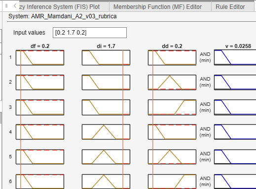
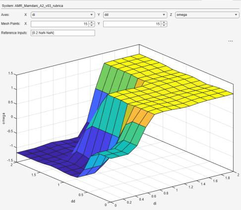

# A2 · Actividad 4 — Consolidación de las reglas Mamdani, superficies y concordancia

**Fecha de auditoría:** 17 de noviembre de 2026. **Repositorio:** `henjacome-dev/AMR_Logistico_Fase_0`. **Rama:** `u3s7-entrega-final-2026-11-16`.
**Estado:** integridad y trazabilidad documental verificadas; concordancia específica del FIS operativo v03 **no acreditada** por la prueba histórica R18.
**Criterios oficiales:** 27 combinaciones, tres entradas `df`/`di`/`dd` en 0–2 m, salidas `v` y `omega`, Rule Viewer / Surface Viewer y diez comparaciones MATLAB–Python con error inferior a 2 %.

## 1. Identidad de los controladores y alcance

| Elemento | Identidad comprobada | Interpretación |
|---|---|---|
| FIS v03 | `matlab/A2_MAMDANI/A2_v03_rubrica/AMR_Mamdani_A2_v03_rubrica.fis` | **Configuración oficial A2/A3**; no editar |
| FIS v01 | `matlab/A2_MAMDANI/AMR_Mamdani_A2_v01.fis` | Prototipo histórico validado en MATLAB |
| CSV histórico | `matlab/A2_MAMDANI/A2_F1_tabla_27_reglas.csv` | **Coincide con v01**, no con v03 |
| CSV creado por esta actividad | `docs/A2_ACT4_REGLAS_V03.csv` | Exportación legible directamente de las 27 reglas v03; no es un nuevo controlador |
| Concordancia R18 | `resultados/A2_R18_equivalencia/evidencia_publicada/A2_R18_comparacion_10_casos.csv` | Comparación **v01** contra referencias MATLAB históricas |
| Capturas v03 | `docs/evidencias_A2/ACT4/` | Imágenes extraídas del informe A19 presentado en Blackboard; no son nuevos cálculos |

**Huellas SHA-256 de los originales:**

- `matlab/A2_MAMDANI/A2_v03_rubrica/AMR_Mamdani_A2_v03_rubrica.fis`: `67dc69177a8e227f84e333977b9366fc57d07c79a37af2d0ae2d5dad56a41903`
- `matlab/A2_MAMDANI/AMR_Mamdani_A2_v01.fis`: `ae1ea3dc2a005b159a1edc7bd1b8b8001c66c815fa475ddce3c17c1a35b16de3`
- `matlab/A2_MAMDANI/A2_F1_tabla_27_reglas.csv`: `33f6e346fb8a508afab36df61184ea57440947d1c066ed5c0242a8857f001023`
- `resultados/A2_R18_equivalencia/evidencia_publicada/A2_R18_comparacion_10_casos.csv`: `dfdbbf1be40d8e9ed9d53bb36a9a97ec184b15930a9706248d7d6c430bb4747b`

La comprobación cruzada con el árbol GitHub del commit `d9a2bcf` confirmó que los blobs de estos cuatro archivos coinciden bit a bit con los del ZIP original U3S7. El SHA-256 del v03 coincide con el identificado en la decisión A13 (`67dc6917…56a41903`).

## 2. Integridad estructural de las 27 reglas

| Comprobación | v01 | v03 oficial |
|---|---:|---:|
| Entradas / salidas | 3 / 2 | 3 / 2 |
| Reglas declaradas y leídas | 27 / 27 | 27 / 27 |
| Combinaciones de antecedentes únicas | 27 / 27 | 27 / 27 |
| Combinaciones `3 × 3 × 3` ausentes | 0 | 0 |
| Peso y conexión | `1`, AND | `1`, AND |
| Operadores | AND=min, OR=max, implicación=min, agregación=max, centroide | Iguales |
| Etiquetas de velocidad | Detenido, Lenta, Rápida | **Lenta, Media, Rápida** |
| Etiquetas de giro | DerechaFuerte, DerechaSuave, Recto, IzquierdaSuave, IzquierdaFuerte | Iguales |

Entre v01 y v03 hay **13 diferencias de índice del consecuente de velocidad** y **16 diferencias de etiqueta lingüística**; el consecuente angular y las tres entradas permanecen iguales. Las funciones de pertenencia de `v` también cambiaron. Por tanto, una comparación numérica satisfactoria de v01 no prueba automáticamente la concordancia de v03.

**Tabla normativa legible de v03 (derivada sin alterar el `.fis`):**

| N.º | df | di | dd | v | omega |
|---:|---|---|---|---|---|
| 1 | Cerca | Cerca | Cerca | Lenta | Recto |
| 2 | Cerca | Cerca | Media | Lenta | DerechaFuerte |
| 3 | Cerca | Cerca | Lejos | Lenta | DerechaFuerte |
| 4 | Cerca | Media | Cerca | Lenta | IzquierdaFuerte |
| 5 | Cerca | Media | Media | Lenta | IzquierdaFuerte |
| 6 | Cerca | Media | Lejos | Lenta | DerechaFuerte |
| 7 | Cerca | Lejos | Cerca | Lenta | IzquierdaFuerte |
| 8 | Cerca | Lejos | Media | Lenta | IzquierdaFuerte |
| 9 | Cerca | Lejos | Lejos | Lenta | IzquierdaFuerte |
| 10 | Media | Cerca | Cerca | Lenta | Recto |
| 11 | Media | Cerca | Media | Lenta | DerechaSuave |
| 12 | Media | Cerca | Lejos | Lenta | DerechaSuave |
| 13 | Media | Media | Cerca | Lenta | IzquierdaSuave |
| 14 | Media | Media | Media | Media | Recto |
| 15 | Media | Media | Lejos | Media | DerechaSuave |
| 16 | Media | Lejos | Cerca | Lenta | IzquierdaSuave |
| 17 | Media | Lejos | Media | Media | IzquierdaSuave |
| 18 | Media | Lejos | Lejos | Media | Recto |
| 19 | Lejos | Cerca | Cerca | Lenta | Recto |
| 20 | Lejos | Cerca | Media | Lenta | DerechaSuave |
| 21 | Lejos | Cerca | Lejos | Lenta | DerechaSuave |
| 22 | Lejos | Media | Cerca | Lenta | IzquierdaSuave |
| 23 | Lejos | Media | Media | Media | Recto |
| 24 | Lejos | Media | Lejos | Media | DerechaSuave |
| 25 | Lejos | Lejos | Cerca | Lenta | IzquierdaSuave |
| 26 | Lejos | Lejos | Media | Media | IzquierdaSuave |
| 27 | Lejos | Lejos | Lejos | Rapida | Recto |

Cada antecedente aparece una sola vez. Esto descarta duplicaciones y omisiones **exactas** de combinaciones lingüísticas; no sustituye el análisis de posibles interacciones de reglas cuando se solapan funciones de pertenencia.

## 3. Superficies y Rule Viewer

Las **nueve imágenes históricas** de `matlab/A2_MAMDANI/evidencias/` pasaron validación de lectura y decodificación PNG; cada una mide **900 × 650 px**: cinco gráficos de funciones de membresía y cuatro superficies:

| PNG histórico | Variables visibles | Entrada fija según generador `A2_F1_superficies.m` |
|---|---|---|
| `superficie_v_df_di_dd_lejos.png` | `v` sobre `df`, `di` | `dd=1.7 m` |
| `superficie_v_df_dd_di_media.png` | `v` sobre `df`, `dd` | `di=0.9 m` |
| `superficie_omega_di_dd_df_cerca.png` | `omega` sobre `di`, `dd` | `df=0.2 m` |
| `superficie_omega_di_dd_df_lejos.png` | `omega` sobre `di`, `dd` | `df=1.7 m` |

**Limitación de versión:** el generador histórico `A2_F1_superficies.m` carga explícitamente `AMR_Mamdani_A2_v01.fis`; las cuatro superficies anteriores **son evidencias v01** y no deben titularse como superficies v03.

De la **página 1, Figura 2, del PDF entregado** `A19_Informe_Tecnico_Avance2_1.pdf` se extrajeron, sin regeneración ni edición del contenido, las capturas incorporadas a continuación. La barra de cada visor identifica `AMR_Mamdani_A2_v03_rubrica`.

**Rule Viewer v03, recorte procedente de la Figura 2(a):**



**Surface Viewer v03, recorte procedente de la Figura 2(b):**



La captura v03 representa `omega` frente a `di`/`dd`, con `df=0.2 m`. Se trata de una evidencia visual contenida en el reporte entregado, **no** de cuatro nuevas superficies v03 verificadas por cálculo numérico.

## 4. Concordancia histórica MATLAB–Python (R18)

Se auditó el CSV publicado y se recalcularon sus errores, sin reejecutar MATLAB ni `scikit-fuzzy`. Los diez escenarios están marcados como aprobados y sus diferencias concuerdan con las columnas de error. **Referencia de esta prueba: v01** (también declarada en `A2_R18_resumen.md`).

| Escenario | v MATLAB | v Python | ω MATLAB | ω Python | Estado R18 |
|---|---:|---:|---:|---:|:---:|
| PasilloLibre | 0.161163 | 0.161111 | 0.000000 | 0.000000 | Sí |
| ObstaculoIzquierdo | 0.070000 | 0.070000 | -0.516667 | -0.516667 | Sí |
| ObstaculoDerecho | 0.070000 | 0.070000 | 0.516667 | 0.516667 | Sí |
| FrenteIzquierdaLibre | 0.011816 | 0.011875 | 1.165516 | 1.164742 | Sí |
| FrenteDerechaLibre | 0.011816 | 0.011875 | -1.165516 | -1.164742 | Sí |
| TresLadosCerca | 0.011816 | 0.011875 | 0.000000 | 0.000000 | Sí |
| FrenteCercaLadosMedios | 0.011816 | 0.011875 | 1.165516 | 1.164742 | Sí |
| FrenteCercaLadosLejos | 0.011816 | 0.011875 | 1.165516 | 1.164742 | Sí |
| DistanciaFrontalUmbral | 0.060448 | 0.060488 | 0.646158 | 0.645217 | Sí |
| DistanciaLateralUmbral | 0.070000 | 0.070000 | -0.516898 | -0.516898 | Sí |

- Casos: **10/10** dentro del criterio histórico de diferencia relativa menor que 2 % (con umbral absoluto en referencias casi nulas).
- Máximo error relativo `v`: **0,502821 %**; máximo error relativo `omega`: **0,145568 %**.
- Máximo error absoluto `v`: **0,0000594113 m/s**; `omega`: **0,000940596 rad/s**.
- Por sí sola, R18 no verifica la versión **v03** utilizada en las actividades operativas ni demuestra evasión autónoma sin asistencia.

## 5. Seguridad y límites metodológicos

1. El hecho de que exista una regla con etiqueta `Lenta` no supone velocidad cero: la salida Mamdani puede ser positiva con obstáculos próximos. La parada estricta es responsabilidad del supervisor ROS 2.
2. La validez matemática de 27 reglas y de las capturas no certifica por sí misma B1–B4; esas pruebas se encuentran documentadas en otras evidencias.
3. Para cerrar el requisito del 2 % **respecto a v03**, es necesario obtener un CSV MATLAB calculado con ese `.fis` y reproducir las mismas diez entradas con una implementación `scikit-fuzzy` basada en v03. No se reemplaza ni altera la prueba v01; ambas deben conservarse con sus versiones.
4. No modificar `AMR_Mamdani_A2_v01.fis`, `AMR_Mamdani_A2_v03_rubrica.fis`, el tag `avance2` ni el tag `final`. La presente actividad agrega únicamente documentos, imágenes extraídas y un verificador de solo lectura.

## 6. Verificador reproducible

Desde la raíz del repositorio en Ubuntu/WSL:

```bash
python3 tools/a2_act4_verificar.py
```

El programa usa únicamente la biblioteca estándar de Python. Comprueba SHA-256, definición FIS, cobertura de 27 reglas, coherencia de los dos CSV de reglas, estructura/CRC de los nueve PNG y los diez casos R18. No recalcula `evalfis`, no ejecuta Gazebo y no modifica archivos.

**Dictamen:** consolidación estática **aprobada** para las evidencias existentes. Queda identificada expresamente la brecha de concordancia MATLAB–Python de la versión v03, sin presentar una prueba de v01 como si correspondiera al FIS operativo.
